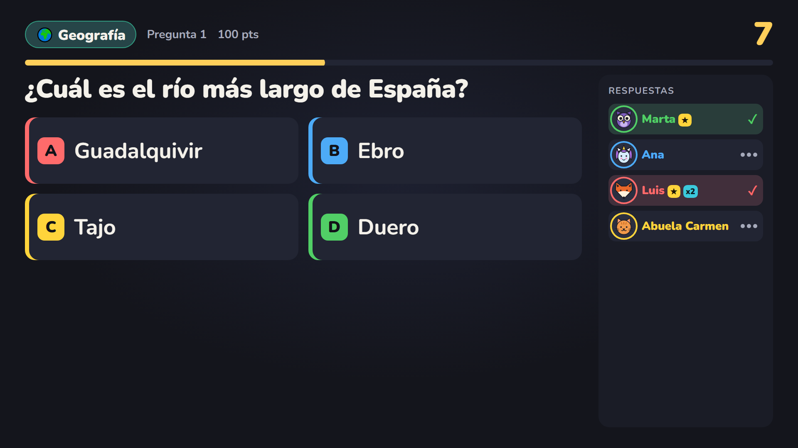
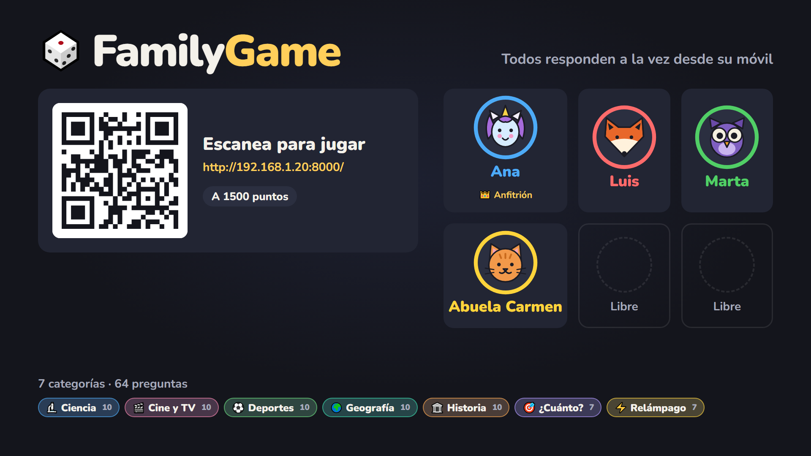
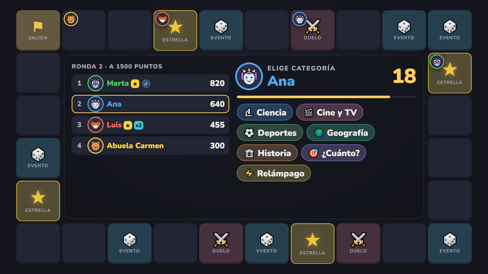
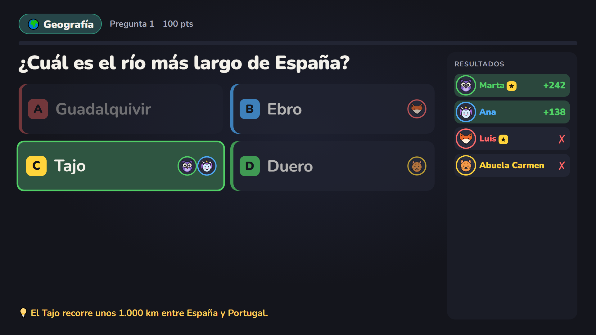
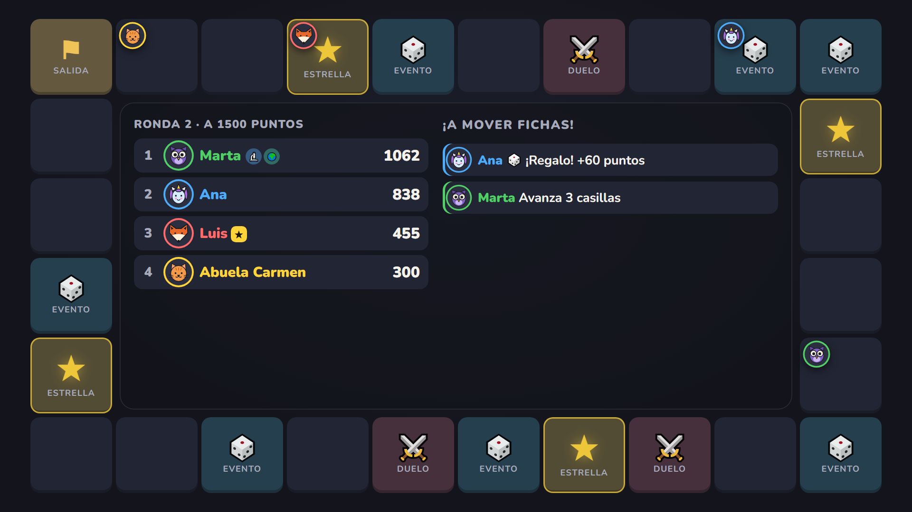
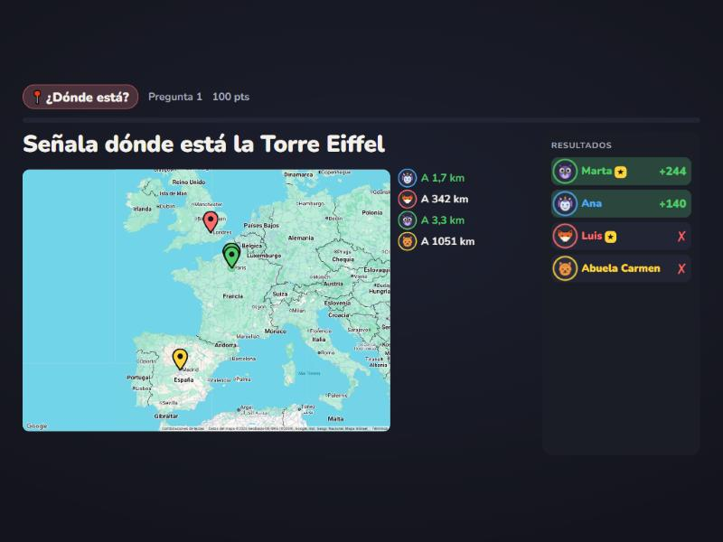
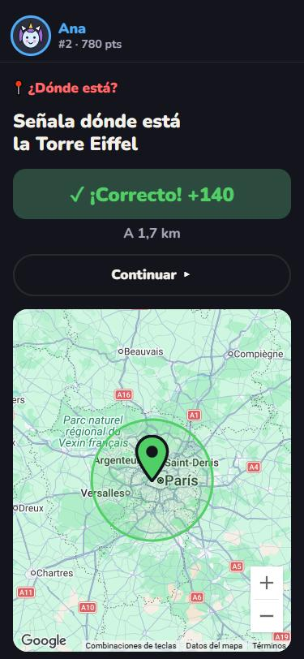
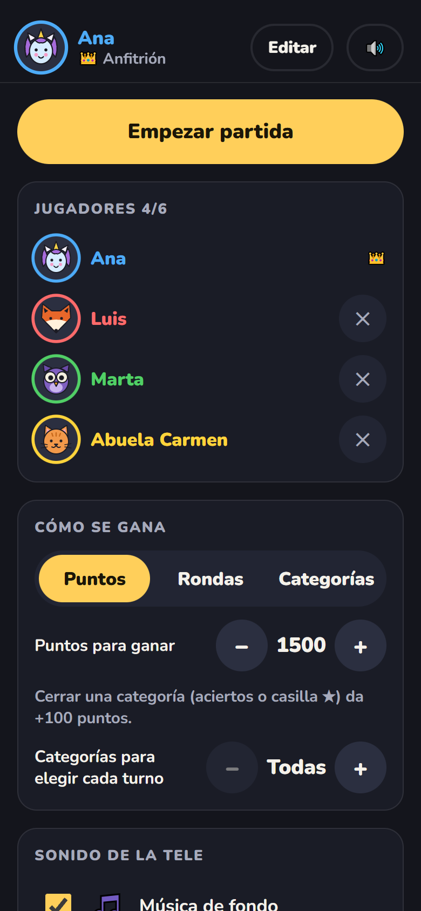
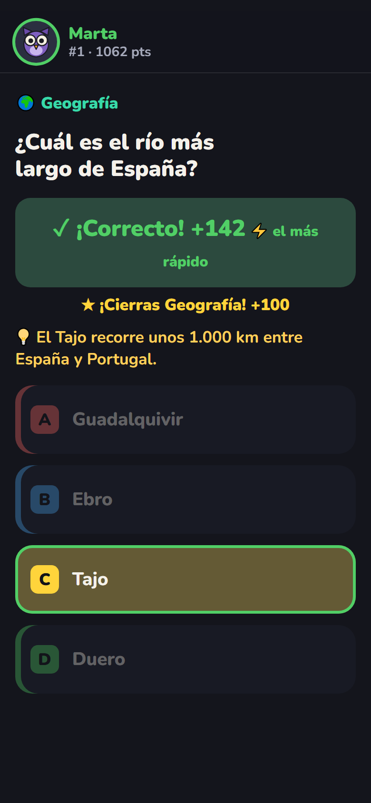

# FamilyGame

Trivial familiar para jugar en la tele: las preguntas y el tablero se ven en una pantalla común y
cada jugador (hasta 6) responde a la vez desde su móvil.



| Lobby | Elegir categoría | Resultados |
|---|---|---|
|  |  |  |
| **Tablero** | **Podio** | |
|  |  | |

Preguntas de mapa (Google Maps): la tele revela la solución con la marca de cada jugador y el móvil
la muestra sobre el mapa.

| Tele | Móvil |
|---|---|
|  |  |

En el móvil:

| Perfil | Elegir | Responder | Resultado |
|---|---|---|---|
|  |  |  |  |

Documentación detallada:

- [docs/preguntas.md](docs/preguntas.md): todos los campos de los archivos de preguntas, con ejemplos.
- [docs/tipos-de-pregunta.md](docs/tipos-de-pregunta.md): cómo programar un tipo de respuesta nuevo.
- [docs/arquitectura.md](docs/arquitectura.md): módulos, fases de la partida, puntuación y protocolo.

## Arrancar

Doble clic en **`iniciar.bat`** (la primera vez crea el entorno e instala dependencias).

- **Tele:** `http://localhost:8765/tv` (se abre sola). Ponla a pantalla completa con F11.
- **Móviles:** escanean el QR de la tele o abren la dirección que aparece debajo
  (los móviles tienen que estar en la misma red wifi que el PC).

A mano: `.venv\Scripts\python src\main.py [--puerto 8765] [--sin-internet]`.

## Cómo se juega

1. Cada jugador entra con nombre, icono (o foto de la galería) y un color.
2. El primero en entrar es el **anfitrión** 👑: elige cómo se gana, qué categorías se juegan y empieza.
3. Por turnos se elige la categoría con una mecánica sorteada: ruleta, cara o cruz (mejor/peor categoría), un rival elige por ti o eliges entre 3 (`docs/mecanicas-categoria.md`). **Todos responden a la vez.**
4. Acertar da puntos (más cuanto antes respondas) y casillas en el tablero:
   2 por acierto, +1 al más rápido.
5. Casillas del circuito:
   - **★ Estrella:** si aciertas la siguiente pregunta estando en ella, cierras su categoría.
   - **🎲 Evento:** puntos dobles, regalo, mala suerte, avanzar, retroceder, robar al líder, cambiar el sitio.
   - **⚔️ Duelo:** retas al jugador con puntos más parecidos; en la siguiente, quien lo haga mejor le roba 50.
   - **Salida:** pasar por ella da +50.
6. **Victoria** (la elige el anfitrión): llegar a X puntos, jugar X rondas, o cerrar X categorías
   (con N aciertos en una categoría o acertando desde una estrella).
   Cerrar una categoría da +100 en cualquier modo.

## Añadir preguntas (sin tocar código)

Cada archivo `.toml` de la carpeta **`preguntas/`** es una categoría, es decir, un tema (puedes usar subcarpetas). Cada pregunta elige su mecánica con `tipo`
(test, slider, rango, mapa, conoces); las de mapa se saltan solas sin clave de Google Maps.
Copia `preguntas/_PLANTILLA.toml`, quítale el guion bajo y escribe. Ahí están documentados todos
los campos. Ejemplo mínimo:

```toml
[categoria]
nombre = "Mi categoría"
icono = "🎲"
color = "#4dabf7"

[[pregunta]]
enunciado = "¿Cuál es la capital de Australia?"
opciones = ["Sídney", "Canberra", "Melbourne"]
correcta = "Canberra"
tiempo = 15
```

Tipos disponibles: `test`, `slider` (un número con tolerancia), `rango` (doble slider con
criterio solapar / contener / coincidir) y `mapa` (punto + radio en metros, o una zona).
Cada pregunta define su propio `tiempo` (2 a 300 s).

Con el servidor arrancado, el anfitrión puede pulsar **«Recargar preguntas»** en el lobby para
ver los cambios sin reiniciar. Las preguntas con errores se ignoran y la tele las lista en el lobby
(archivo y motivo); el resto de la categoría sigue funcionando.

## Guardar la partida y volver al menú

El anfitrión tiene en su móvil, durante la partida, el botón **«💾 Guardar y volver al menú»**
(y «Terminar sin guardar» si no quiere conservarla). La partida se guarda en
`data/partida_guardada.json` con los puntos, casillas, categorías cerradas, rondas y fotos.

- Si había una pregunta abierta, se descarta y vuelve a elegir quien tenía el turno.
- En el menú (lobby) aparece la tarjeta **«Partida guardada»** con **Continuar** y **Descartar**.
  Sobrevive a cerrar y volver a abrir el programa: los móviles recuperan su jugador solos.
- Al continuar, quien no está conectado queda como «desconectado» y se salta su turno; quien se
  haya unido después entra con 0 puntos. Solo hay una partida guardada (guardar otra la sustituye).
- No se puede guardar durante un desempate.

**Autoguardado:** al acabar cada pregunta se guarda solo en `data/autoguardado.json`. Si se va la
luz o se cierra el programa, al volver a abrirlo el lobby ofrece continuar esa partida. Se borra
cuando la partida termina o se vuelve al lobby sin más.

## Salir, echar, volver y pausa

El botón **👥** de la cabecera del móvil abre la pantalla **Jugadores**, en cualquier momento.

- **Salir:** cualquiera puede salir de la partida. Su plaza queda reservada con sus puntos, casilla
  y categorías cerradas, pero **desaparece de la clasificación** mientras esté fuera.
- **Volver:** si vuelve a abrir el juego desde el mismo móvil (misma IP de la red local), aunque
  escriba otro nombre, el juego le pregunta «¿Ya estabas jugando? Soy …» y recupera su estado.
  Las IP solo se guardan en memoria, no en disco.
- **Echar:** el anfitrión puede echar a alguien (móvil estropeado, por ejemplo). A quien se echa
  **no** se le reconoce solo; su móvil le ofrece «Reintentar» o entrar como nuevo, y el anfitrión
  puede **readmitirlo** (recupera su estado) o **liberar** su plaza. Si ya ha entrado con otro
  móvil, el anfitrión puede decir «es él» y se le asigna el estado.
- **Plazas:** las reservadas cuentan para el máximo de 6 hasta que el anfitrión las libera.
- **Mando:** si el anfitrión se va o se desconecta, pasa al siguiente y la tele lo anuncia.
  El anfitrión también puede dar el mando a otra persona.
- **Dos pestañas:** si alguien abre el juego en otra pestaña, la anterior avisa y deja de funcionar;
  «Usar esta pestaña» la recupera.
- **Pausa:** cualquiera puede pausar con ⏸ (los relojes se congelan en la tele y los móviles).
  La reanuda el anfitrión, o quien la pausó.
- **Pausa automática por ausencia:** el móvil avisa cuando su pestaña se oculta (bloqueo de pantalla,
  minimizar, cambiar de app), manda un latido cada 4 s y el servidor nota si se cierra la conexión
  o el latido se corta 15 s. Con 4 s de margen, la partida se pausa sola y **solo el anfitrión**
  reanuda. Al reanudar se sigue sin quien siga ausente (no vuelve a pausar por él).
- **Quien entra con la partida empezada:** el anfitrión elige si empieza con 0 puntos, con la media
  o con unos puntos fijos (en la pantalla Jugadores).

## Sonido

La tele reproduce efectos (acierto, fallo, cuenta atrás, eventos del tablero, fanfarria…) y una
música tranquila de fondo que no se repite exactamente. Todo se genera en el navegador con
WebAudio: no hay archivos de audio ni licencias.

- **Silenciar o ajustar:** el anfitrión tiene un botón 🔊/🔇 en la cabecera de su móvil (en cualquier
  pantalla) y, en el lobby, la tarjeta «Sonido de la tele» con música, efectos y volumen.
- **Solo en esa tele:** pulsa **M** en el teclado de la tele para silenciarla sin tocar el ajuste.
- **Primer clic:** los navegadores bloquean el audio hasta que hay un clic o una tecla; la tele
  muestra un aviso abajo a la derecha hasta que se activa.
- La música baja de volumen mientras hay una pregunta abierta.

## Mapas

Las preguntas `mapa` usan Google Maps. Pon tu clave de la *Maps JavaScript API* en
**`config.local.toml`** (archivo local que Git ignora, así la clave no se sube al repositorio):

```toml
[mapas]
google_maps_api_key = "tu-clave"
```

`config.local.toml` pisa los valores de `config.toml`. Restringe la clave por referente HTTP en la
consola de Google, porque viaja a los navegadores. Sin clave o sin internet, esas preguntas no se
ofrecen; si el mapa falla en un móvil concreto, a ese jugador la pregunta no le cuenta.

## Crear un tipo de pregunta nuevo

Copia `question_types/_plantilla` a una carpeta nueva (sin `_` delante) y edita:

| Archivo | Qué hace |
|---|---|
| `type.py` | Clase que hereda de `QuestionType`: lee y valida los campos del archivo, valida la respuesta del móvil y decide si es correcta. |
| `tv.js` | `renderTV(canvas, q, ctx)`: lo que se ve en la tele y cómo se revela la solución. |
| `phone.js` | `renderPhone(canvas, q, ctx)`: los controles para responder; envía con `ctx.submit(valor)`. |
| `style.css` | Estilos del tipo (opcional). |

El juego descubre la carpeta al arrancar; el valor de `type_id` es lo que se escribe en `tipo = "..."`.

## Decisiones de partida

- **Empates:** pregunta de desempate a muerte súbita entre los empatados (se prefieren sliders:
  gana el más cercano). Tras 3 intentos sin desempate, victoria compartida.
- **Nombres repetidos:** no se permiten (sin distinguir mayúsculas ni tildes).
- **Colores:** paleta fija de 12, todos legibles sobre el fondo de la tele; cada color, un jugador.
- **Desconexiones:** el móvil se reconecta solo y recupera su jugador. Si quien elige se va, la
  categoría sale al azar. Si no queda nadie conectado, el reloj se congela. El anfitrión puede
  sacar a un jugador. Se puede entrar con la partida empezada (con 0 puntos).
- **Repeticiones:** una pregunta no sale dos veces en la misma partida; además se prefieren las que
  no salieron en partidas anteriores (`data/historial.json`). Si se agotan, se avisa y se repiten.
- **Categorías grandes y pequeñas:** «Al azar» elige categoría con la misma probabilidad para todas,
  tenga 200 preguntas o 10. El anfitrión puede limitar cuántas categorías se ofrecen cada turno.
- **Fotos:** se reducen a 256 px en el móvil, se guardan en el propio móvil para la próxima vez y
  el servidor solo las tiene en memoria durante la sesión.

## Configuración

`config.toml`: puerto, clave de mapas, máximo de jugadores y segundos de cada fase.

## Desarrollo

```powershell
.venv\Scripts\python -m pytest
```

Las capturas de este README se regeneran con `.venv\Scripts\python tools\capturas.py` (usa Edge
en modo headless y las escenas congeladas de `tools/demo.py`).

Estructura: `src/familygame` (motor, carga de preguntas, servidor), `question_types/` (tipos),
`preguntas/` (categorías), `web/` (pantallas de tele y móvil), `tests/`.
